# ZeroLantern 5D2 — Menu Architecture & UX Restructuring Proposal

---

## 1. Executive UX Evaluation: Magic Lantern vs. Canon Native Menu

| Evaluation Dimension | Canon EOS 5D Mark II Native Menu | Legacy Magic Lantern Menu | ZeroLantern 5D2 Proposed Menu |
| :--- | :--- | :--- | :--- |
| **Cognitive Load** | **Low**: 6–8 distinct items per page; color-coded tabs; no scrolling per screen. | **Very High**: Monospace text wall; deeply nested obscure acronyms; up to 15 items per page. | **Low / Optimal**: Grouped by photographic workflow; clear English labels; maximum 6–7 items per page. |
| **Visual Hierarchy** | **Clear**: Large categorical icons (Red, Blue, Yellow, Orange), explicit ON/OFF status pills and sliders. | **Minimal**: Monochromatic text; small binary square boxes (`[x]`, `[ ]`); cramped layout. | **Modernized**: Status pills (`[ON]`, `[OFF]`, `[AUTO]`), live dynamic values (`Portra 400`, `-2 EV`). |
| **Navigation Model** | **Consistent**: Main dial scrolls tabs; Quick Control dial navigates items; `SET` selects/confirms. | **Inconsistent**: Some items use `SET`, some `Q`, some `PictureStyle`, some popup pickers, some left/right. | **Canon-Aligned**: Main dial cycles tabs; Quick Control dial navigates; `SET` toggles; `Q` opens submenus. |
| **Domain Scope** | Clear boundary between shooting, playback, setup, and custom functions. | Mixed video, audio, games, debugging, and photo features crammed together. | **100% Dedicated Still Photography**: Zero video/audio clutter; pure focus on optics, light, and RAW capture. |

---

## 2. Proposed 5-Tab Photographic Workflow Hierarchy

```mermaid
flowchart TD
    subgraph ZeroLantern["ZeroLantern 5D2 Menu (Photographer-Centric)"]
        Tab1["🔴 Tab 1: EXPO<br/>(Exposure & Shutter Timing)"]
        Tab2["🟣 Tab 2: COLOR / LOOK<br/>(Film Simulation & Filters)"]
        Tab3["🔵 Tab 3: OPTICS & FOCUS<br/>(Sharpness & Calibration)"]
        Tab4["🟢 Tab 4: CAPTURE<br/>(Pure RAW & Sensor Readout)"]
        Tab5["🟡 Tab 5: OVERLAY<br/>(LiveView Metrics & Scopes)"]
        Tab6["⚪ Tab 6: SYSTEM<br/>(Hardware & Profiles)"]
    end

    Tab1 --> E1["Auto-ETTR (CMOS-level Auto Exposure)"]
    Tab1 --> E2["Bulb Timer (1s to 8h precision)"]
    Tab1 --> E3["Bulb ND Calculator (ND4 to ND32000 presets)"]

    Tab2 --> C1["Film Simulation (Portra, Velvia, Kodachrome, Tri-X)"]
    Tab2 --> C2["Live Electronic GND (Horizon level, soft/hard slope)"]
    Tab2 --> C3["Live ND Attenuation Simulator"]
    Tab2 --> C4["Picture Style Quick Switch"]

    Tab3 --> O1["Trap Focus (Instant shutter upon sharp plane)"]
    Tab3 --> O2["Focus Peaking (Real-time edge contrast highlights)"]
    Tab3 --> O3["Focus Stacking (Automated micro-rack stepping)"]
    Tab3 --> O4["DotTune (Automated AF Microadjustment)"]

    Tab4 --> S1["Full-Res Silent Picture (100% Electronic Shutter DNG)"]
    Tab4 --> S2["Dual ISO (14.2+ Stops Dynamic Range Readout)"]
    Tab4 --> S3["Advanced Intervalometer (Deflickered Timelapse)"]
    Tab4 --> S4["Mirror Lockup (MLU) & Handheld Shake Guard"]

    Tab5 --> L1["14-bit RAW Histogram (Real-time CMOS exposure)"]
    Tab5 --> L2["RAW Spotmeter (Direct EV reading on AF point)"]
    Tab5 --> L3["RAW Zebras (Pure sensor highlight blowout warning)"]
    Tab5 --> L4["Composition Grids (Golden Ratio, Rule of Thirds)"]
```

---

## 3. Tab-by-Tab Detailed Menu Specification

### 🔴 Tab 1: EXPO (Exposure Management)
* **Auto-ETTR**:
  - `Trigger`: Half-shutter press / Auto / Manual
  - `Highlight Target`: 0.1% to 1.0% clipping tolerance
  - `SNR Limit`: Minimized shadow noise priority
* **Bulb Timer**:
  - `Duration`: 1 sec to 8 hours with millisecond accuracy
  - `Display Countdown`: Backlight OLED / LCD auto-off during bulb exposure
* **Bulb ND Calculator**:
  - `Preset`: Quick picker (`ND4` / 2-stop up to `ND1000` / 10-stop and `ND32000` / 15-stop solar)
  - `Calculated Shutter`: Automatic synchronization with base metering

---

### 🟣 Tab 2: COLOR / LOOK (Film Simulation & Optical Filters)
* **Film Simulation**:
  - `Profile`: `OFF`, `Kodak Portra 400`, `Fuji Velvia 50`, `Kodak Kodachrome 64`, `Fuji Classic Chrome`, `CineStill 800T`, `Ilford HP5+ 400`, `Kodak Tri-X 400`, `Sepia Vintage`
  - `LiveView Preview`: Real-time 30+ fps VRAM lookup table without dynamic allocation
* **Electronic Live GND**:
  - `Sky Attenuation`: 1 to 4 stops
  - `Horizon Level`: 10% to 90% screen height
  - `Transition Type`: Soft Edge / Hard Edge
* **Live ND Simulation**:
  - `Attenuate`: 1 to 6 stops preview on LCD

---

### 🔵 Tab 3: OPTICS & FOCUS (Sharpness & Lens Alignment)
* **Trap Focus**:
  - `Mode`: Hold AF button / Continuous / One-shot
  - `Lens Mode`: Manual Focus (MF) confirmation latch
* **Focus Peaking**:
  - `Color`: Red, Green, Cyan, White
  - `Threshold`: Low, Medium, High contrast sensitivity
* **Focus Stacking**:
  - `Rack Step Size`: 1 to 10 lens micro-motor ticks
  - `Total Bracket Frames`: 2 to 50 shots
* **DotTune AFMA**:
  - Automated microadjustment calibration using phase-detection autofocus stats

---

### 🟢 Tab 4: CAPTURE (RAW Sensor Readout)
* **Full-Res Silent Picture**:
  - `Output`: Full-resolution `.DNG` raw files
  - `Mechanism`: Direct sensor EDMAC DMA transfer without mechanical shutter wear
* **Dual ISO**:
  - `Recovery ISO`: ISO 100 / ISO 800 or ISO 100 / ISO 1600
  - `Dynamic Range Boost`: Yields up to 14.2+ stops
* **Advanced Intervalometer**:
  - `Take a picture every`: 1s to 60 min
  - `Deflicker Ramp`: Automatic exposure ramping for day-to-night holy grail timelapses

---

### 🟡 Tab 5: OVERLAY (Sensor Metrics)
* **RAW Histogram**:
  - RGB + Luminance 14-bit histogram based directly on ADC values before picture style gamma curves
* **RAW Spotmeter**:
  - Percentage & EV delta relative to 18% middle gray at current AF point
* **RAW Zebras**:
  - Highlights overexposed at 15500 ADC level (true clipping indicator)

---

## 4. Key Physical Button Mappings on 5D Mark II

| Camera Control | In Shooting Mode (LiveView / OVF) | Inside ZeroLantern Menu |
| :--- | :--- | :--- |
| **`DELETE` Button** | Open / Close ZeroLantern Menu | Exit Menu to LiveView / OVF |
| **`Q` (Picture Style) Button** | Quick Control screen | **Open Submenu / Detailed Parameters** |
| **Top Main Dial** | Shutter Speed adjustment | **Cycle Horizontal Tabs (Expo -> Look -> Focus...)** |
| **Rear Quick Control Dial** | Aperture adjustment | **Scroll Vertically through Menu Items** |
| **`SET` Button** | Center AF point | **Toggle item ON/OFF or step choices** |
| **Joystick / Multi-Controller**| Move AF point | Direct parameter nudge & custom horizon positioning |
