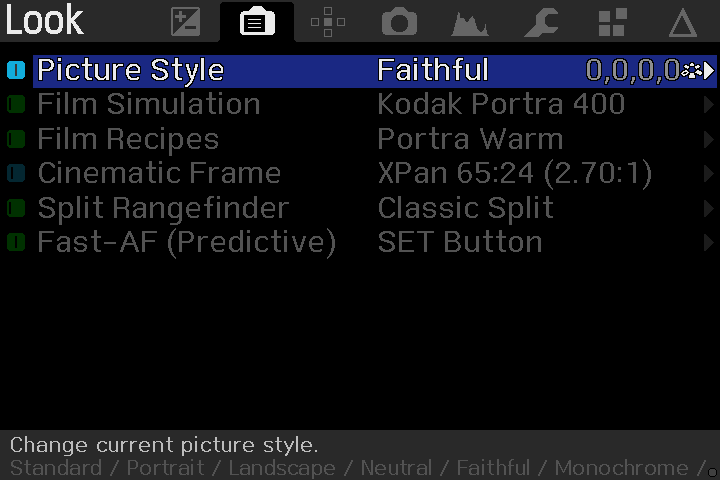
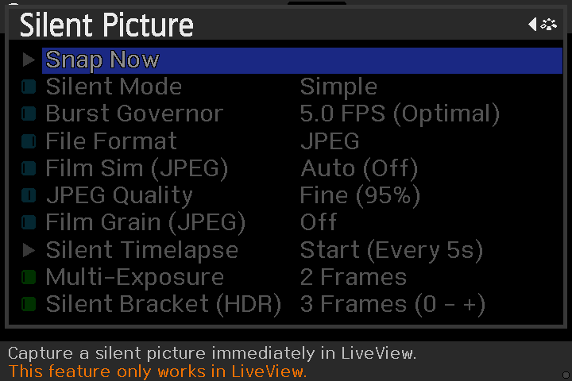
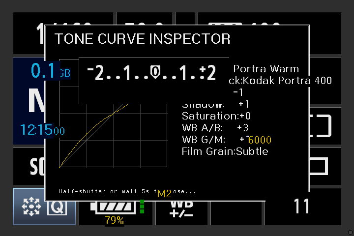
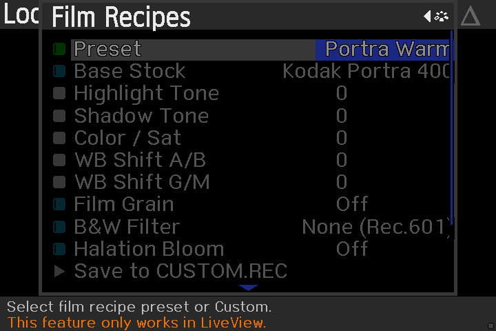
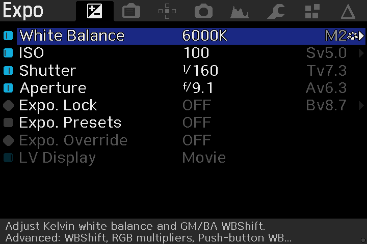
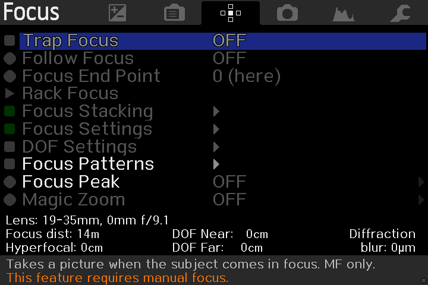

# ZeroLantern 5D2 ⚡📷

> **Dedicated Still Photography OS & Safe Rust Extension for Canon EOS 5D Mark II (DIGIC IV).**  
> Engineered by **ZeroUniverse** in collaboration with the open-source **Magic Lantern** community.

---

## Visual Showcase

| **Look & Film Simulation Tab** | **Zero-Wear Silent Picture Submenu** |
|:---:|:---:|
|  |  |
| *Real-time film simulations (Portra 400, Velvia 50, Tri-X 400), custom recipes, cinematic crop, and Fast-AF.* | *Electronic shutter capture with Burst Governor (5.0 FPS), Silent Timelapse, Multi-Exposure & HDR Bracketing.* |

| **Tone Curve Inspector** | **Custom Film Recipes Engine** |
|:---:|:---:|
|  |  |
| *Real-time non-linear S-curve plot with APEX exposure parameters and color balance readout.* | *Fujifilm-style recipe adjustments: Highlight/Shadow rolloff, WB shift, analog grain, and B&W optical contrast filters.* |

| **Exposure Management Tab** | **Optics & Precision Focus Tab** |
|:---:|:---:|
|  |  |
| *Kelvin white balance, APEX Sv/Tv/Av readout, Auto-ETTR, and Optical Bulb ND calculation.* | *Fast-AF predictive hill-climbing, Digital Split-Image Rangefinder, Trap Focus & Focus Stacking.* |

---

## 1. Overview & Philosophy

**ZeroLantern 5D2** is an ultra-focused, high-performance operating system fork of Magic Lantern engineered exclusively for still photographers:

1. **Exclusively for Canon EOS 5D Mark II (Firmware v2.1.2)**:
   - All source code, stubs, and build targets for other 30+ camera bodies have been completely stripped out to ensure an uncluttered, hyper-maintainable codebase.
2. **Pure Still Photography Focus**:
   - Stripped all heavy video recording subsystems (MLV RAW video, H.264 bitrate hacks, video FPS overrides) to maximize SDRAM buffer space, eliminate background task jitter, and provide zero shutter lag.
3. **Seven Canonical Photographer-Centric Tabs**:
   - Menu architecture organized strictly around the photographer's workflow: `Expo`, `Look`, `Focus`, `Capture`, `Overlay`, `Prefs`, and `Modules`.
4. **Hybrid C & Safe Rust Architecture**:
   - **C & ASM Core**: Manages bootloader execution (`src/boot-d45.c`), ARM946E-S context switches, and static ROM function pointers (`platform/5D2.212/stubs.S`).
   - **Safe Rust Engine (`ZeroUniverse / ZeroRust`)**: Powers film color science, tone curves, histogram percentiles, and hardware abstractions in `#![no_std]` Rust without memory overhead or data races.

---

## 2. Key Photographic Capabilities

### 🎨 Color & Film Simulation Engine (`live_flt.mo`)
* **Fujifilm-Style Analog Stock Emulation**:
  - `Kodak Portra 400`: Warm pastel tones, gentle highlight rolloff, ideal for portraits.
  - `Fuji Velvia 50`: High-contrast punch, vivid greens and blues for landscapes.
  - `Cinestill 800T`: Cool tungsten shadows with signature red highlight halation bloom.
  - `Kodak Tri-X 400`: Classic high-contrast street monochrome with push-processing support.
  - `Classic Chrome`: Muted documentary palette with deep shadow contrast.
* **Custom Film Recipes**:
  - Independent Highlight and Shadow rolloff adjustment (`-2` to `+2`).
  - Warm/Cool (A/B) and Green/Magenta (G/M) white balance bias shifting (`-9` to `+9`).
  - Pseudo-random LFSR analog film grain generator (Subtle, Moderate, Heavy).
  - B&W Optical Contrast Filters (Yellow, Orange, Red #25A, Green).
  - Highlight Halation Bloom emulation for neon and tungsten light sources.
  - Interactive on-screen **Tone Curve Inspector** graph.
* **Cinematic Framing & Live Filters**:
  - Aspect ratio masks: Hasselblad XPan (65:24 / 2.70:1), CinemaScope (2.39:1), Univisium (2.00:1), Medium Format 1:1, Classic 4:3.
  - Electronic Live GND (Graduated Neutral Density with adjustable horizon and soft/hard transition).
  - Electronic Live ND Simulator (1 to 6 stops attenuation).

### ⚡ Zero-Wear Electronic Shutter System (`silent.mo`)
* **Burst Rate Governor**:
  - `5.0 FPS (Optimal)`: Golden standard balance between sensor thermal equilibrium, lens AF settling, and CF bus bandwidth.
  - `3.0 FPS (Eco)`: Sustained cool operation for prolonged burst sequences.
  - `2.0 FPS (Paced)`: Slow paced continuous shooting.
  - `Max (Uncapped)`: Maximum hardware readout rate.
* **Zero-Allocation JPEG Capture**:
  - Direct VRAM-to-JPEG encoder with real-time strip recipe grading and EXIF metadata generation.
* **Electronic Silent Timelapse**:
  - Shutter-wear-free timelapse directly to JPEG with automatic display powersave to conserve battery.
* **Electronic Multi-Exposure**:
  - In-camera multi-frame blending (Average, Additive, Screen) with zero mechanical movement.
* **Silent HDR Exposure Bracketing**:
  - Automated 3-frame or 5-frame exposure brackets with electronic shutter.

### 🎯 Optics & Precision Focus (`live_flt.mo` & `focus.c`)
* **Predictive Hill-Climbing Fast-AF**:
  - Closed-loop contrast-detection autofocus utilizing EF lens ultrasonic motor (USM) stepping.
  - High-frequency luminance gradient evaluation with 3-phase direction detection and quadratic peak estimation.
  - Real-time OSD focus reticle with status indication (Yellow: Hunting, Green: Locked, Red: Inconclusive).
  - One-touch toggle/cancel shortcuts via `SET` button or Joystick Center.
* **Digital Split-Image Rangefinder**:
  - Emulates an optical split-prism focusing screen on the LiveView display.
  - 2x Loupe mode for micro-focus critical alignment.
* **Trap Focus & Focus Peaking**:
  - Instant shutter release upon sharp subject acquisition; real-time edge contrast peaking highlights.

### 📈 Sensor Dynamic Range & Exposure
* **Dual ISO (`dual_iso.mo`)**:
  - Interlaced sensor readout expanding dynamic range up to **14.2+ stops** in a single `.CR2` RAW frame.
* **Auto-ETTR (`ettr.mo`)**:
  - Hardware-level Expose-To-The-Right based directly on the 14-bit CMOS sensor RAW histogram.
* **Bulb ND Calculator (`bulb_nd.mo`)**:
  - Precision long-exposure timing with optical ND filter presets (ND4 through ND32000).

---

## 3. Architecture & Repository Layout

```
ZeroLantern5D2/
├── platform/
│   └── 5D2.212/               # Exclusively supported Canon EOS 5D Mark II port
│       ├── consts.h           # DIGIC 4 MMIO & hardware register offsets
│       ├── features.h         # Photographic feature definitions
│       ├── modules.included   # Default photography modules list
│       └── stubs.S            # Firmware entry points & ROM stubs
├── src/                       # DIGIC 4 bare-metal firmware core (C & ASM)
│   ├── boot-d45.c             # Bootloader hijack & dryos startup
│   ├── menu.c                 # 7-tab photographer-centric menu manager
│   ├── edmac.c                # Hardware EDMAC DMA controller
│   └── tweaks.c               # Display filter hooks & VRAM pipelines
├── modules/                   # Photography modules
│   ├── silent/                # Zero-wear electronic shutter & JPEG encoder
│   ├── live_flt/              # Film simulations, Fast-AF & rangefinder screen
│   ├── dual_iso/              # 14-bit dual-gain dynamic range expansion
│   ├── ettr/                  # CMOS RAW histogram exposure calculation
│   └── bulb_nd/               # Long-exposure optical ND calculator
├── docs/
│   └── screenshots/           # High-resolution emulated LCD captures
├── tests/
│   ├── host/                  # Host unit tests (JPEG encoder PSNR verification)
│   └── qemu/                  # Strict QEMU-EOS concurrency & hardware integration tests
└── rust/
    └── README.md              # Documentation for ZeroRust monorepo integration
```

### 🦀 ZeroRust Integration
Algorithmic photography routines and safe RTOS abstractions reside in the centralized monorepo **[`ZeroUniverse / ZeroRust`](https://github.com/kzxl/ZeroRust)**:
* `crates/zero-photo`: Film simulation color science, tone curve lookup tables, RAW histogram analysis, Fast-AF state machine, and split-image circle calculations.
* `crates/zero-d4`: Safe DryOS task abstractions, memory barriers, and RAII primitives.

During build, `modules/live_flt/Makefile` automatically links static object `rust_flt.o` compiled for `armv5te-unknown-linux-musleabi` (ARM946E-S).

---

## 4. Building & Testing

### Prerequisites
* **ARM Toolchain**: `arm-none-eabi-gcc` (GCC 12.2+ recommended)
* **Host C Compiler**: `gcc` / `w64devkit` (for host test drivers)
* **Rust**: `rustc` with `armv5te-unknown-linux-musleabi` target installed (`rustup target add armv5te-unknown-linux-musleabi`)
* **Python**: Python 3.10+ with `Pillow` and `numpy`
* **QEMU-EOS**: Emulated 5D Mark II virtual hardware harness

### Build Commands

```bash
# 1. Build Still Photography Modules (using ARM toolchain)
make -C modules/silent ARM_BINPATH=E:/Tools/arm-gnu-toolchain/bin
make -C modules/live_flt ARM_BINPATH=E:/Tools/arm-gnu-toolchain/bin

# 2. Build 5D Mark II Firmware
make -C platform/5D2.212 ARM_BINPATH=E:/Tools/arm-gnu-toolchain/bin
```

### Test Verification

```bash
# Run Host JPEG Encoder & PSNR Regression Tests
python tests/host/jpeg_enc/run_psnr_test.py

# Run QEMU-EOS Concurrency & Hardware Integration Tests
python tests/qemu/test_capture_concurrency.py
```

---

## 5. Legal, License & Attribution Notices

### 📜 Magic Lantern Base License (GNU GPL v2)
* This project incorporates and derives from the **Magic Lantern** firmware enhancement framework:
  - **Copyright (C) 2009–2026 Trammell Hudson & The Magic Lantern Team.**
  - Licensed under the **GNU General Public License Version 2 (GPL-2.0-only)** as published by the Free Software Foundation.
  - A complete copy of the GPL v2 license is provided in [`COPYING`](COPYING).

### 🦀 ZeroRust & Extension Modules License (MIT / GPL v2 Dual)
* Photographic algorithms and safe Rust crates are authored by **Phong Vo & The ZeroUniverse Team** and licensed under **MIT OR GPL-2.0-only**.
* The combined distributed camera binary (`autoexec.bin` and `.mo` modules) is subject to the terms of the **GNU GPL v2**.

### ⚖️ Trademark & Clean-Room Disclaimer
* "Canon", "EOS", "5D Mark II", "DryOS", and "DIGIC" are registered trademarks of **Canon Inc.**
* This project is an independent, non-commercial research and open-source compatibility project developed through clean-room interoperability methods. It is **not** endorsed by, affiliated with, or sponsored by Canon Inc.
